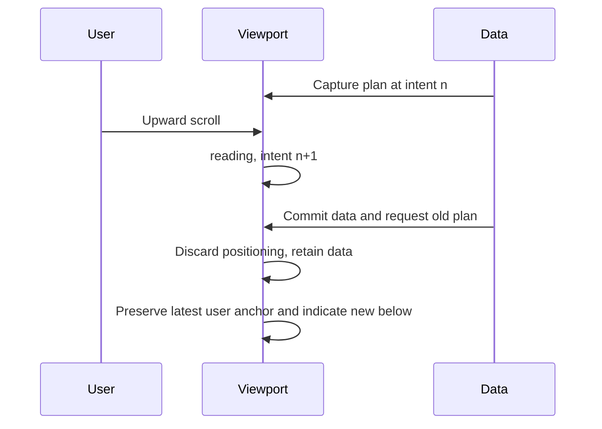

# Viewport ownership and contracts

## Ownership
ChatView owns conversation data and submits changes to a single useConversationViewport controller. The controller owns all application scroll writes, mode, anchor, new-content flag and navigation versions. readingPosition stores at most 50 per-pane session records. Transcript parsers own stable item identity. Existing single-flight tail loading remains the request owner; request validity and scroll-plan validity are separate.

## State
- mode: following | reading; no persistent seeking state.
- hasNewBelow: boolean, not a read receipt/count.
- anchor: stable block/item identity, internal text position and viewport-relative CSS px offset, or null.
- intentVersion: monotonic number; new input/navigation cancels old geometry plans.
- pending navigation: transient intent-versioned frame/target; no third reading mode.
- view lifetime: callbacks verify the same live element, pane identity and disposal state.

Following output stays at bottom. Any upward wheel/touch/key/thumb intent enters reading; user downward arrival within 2 CSS px enters following. Geometry-induced scroll events cannot alone change mode. Quick answers hold reading; only successful send/explicit latest requests follow.

## Source boundary (v1)
ChatItem.id and offset are optional for old offline records and synthetic fixtures, mandatory for newly parsed source items. id identifies source line and logical block without incorporating mutable text/line length; offset is an absolute UTF-8 byte position. The server validates the exact id and file on anchor restore. Missing identity uses an in-view fallback only and is not represented as a durable source location.

The emitted ID is `v1:<offset>:<URI-encoded logical slot>:<16-hex metadata fingerprint>`. Slots identify source content blocks, not filtered output indices. The fingerprint uses immutable record-envelope metadata; the persisted passage witness additionally validates text on restore.

Range responses have older:true, start/end exclusive complete-line byte bounds, items. GET /api/chat?pane=P&around=ID&file=F returns position:found|not-found|source-changed. A transient transport/read failure remains an error, never not-found. GET /api/chat?pane=P&after=A&before=B reads a bounded forward page in [A,B), making progress. Range reads bypass normal tail-delta caching; identical data is idempotent. Normal tail responses expose end. Shared types are the sole wire field definition.

Examples: a found response carries position:found and a page containing the exact id; a wrong file returns position:source-changed with no replacement tail; an absent id returns position:not-found. Empty complete range has items:[] and equal start/end, not a failed restore.

```json
{"available":true,"file":"session.jsonl","older":true,"position":"found","start":4096,"end":8192,"items":[{"id":"v1:4096:content%2F0:0123456789abcdef","offset":4096,"role":"assistant","text":"The saved passage.","ts":null}]}
```

```json
{"available":true,"file":"session.jsonl","older":true,"position":"source-changed","start":0,"end":0,"items":[]}
```

```json
{"available":true,"file":"session.jsonl","older":true,"start":8192,"end":8192,"items":[]}
```

## Rendering and positioning
Stable source keys replace tail-relative indices for real transcript blocks; derived groups use their first stable constituent. Anchors can resolve after DOM replacement and include a text position for long blocks. Keep browser native anchoring and correct only measured residual displacement, never total scrollHeight delta. Coalesce geometry callbacks; ignore residuals <=2 CSS px. During native gesture/inertia do not write automatic scroll positions; defer layout-changing historical commits, then rebase to the user's latest position. Use scrollend where available with input-release/scroll-quiet fallback, including no-scroll gestures.

Keep downward intent after the 160 ms idle fallback so a late compositor scroll can still complete manual arrival. New input, explicit navigation, application writes or idle extent changes retire that intent. Compare clamped scroll offsets and the scrollable extent before accepting arrival: rubber-band return and geometry-only clamps are not user navigation. Rebase impossible reading anchors when a clamp occurs, including during an input window.

Phone controls share a 12 CSS px right inset: the 44 px key toggle is 8 px above its lower boundary; latest is another 8 px above it. The new-content label expands left while its down arrow remains aligned with the key chevron. Neither control participates in message layout.

Disable UChatMessages mounted and independent button scrolling. Search highlighting can refresh without refocusing. Search/origin/unanswered navigation uses controller targets within the chat box. Immediate latest positioning avoids a long animation competing with input; reduced-motion is inherently respected.

Content-commit and explicit restore compensation complete synchronously after Vue's DOM commit. Deferring that compensation to a later frame allowed another idle reveal to capture the uncorrected position as its new anchor. Resize/mutation/font notifications remain frame-coalesced. Snapshotting on navigation uses the last valid semantic anchor, not teardown geometry.

When a viewport enlargement or content shrink clamps scrollTop, rebase any geometrically unattainable anchor offset to the actual visible context without entering following. Otherwise later output creates enough room to replay the old compensation debt and moves content the user has already resumed reading.

## Restore and continuity
Store source file identity, semantic anchor, last-known output boundary and indication. Source IDs validate the record envelope; the saved text witness validates the passage. Restore reads the latest tail, resolves the anchor locally or requests a bounded historical page, then mounts that page with an explicit gap before the live tail. Fill gaps forward without pretending nonadjacent ranges join. Tail-window movement retains valid old range; detected rewrites/session changes invalidate source positions. Save the current user position, not a stale pregesture anchor. Errors retain data and expose retry; invalid content is visibly reported and keeps available context rather than claiming a successful restoration.

## Mind-Test
| Case | Event ordering | Required outcome |
| --- | --- | --- |
| MT01 | capture follow plan, upscroll, append, old RAF | old follow discarded; reading+indicator |
| MT02 | history request, further scroll, response | capture latest anchor at commit |
| MT03 | latest command, more output | clear only at current bottom |
| MT04 | latest command, upward input | cancel old callback |
| MT05 | keyboard, image load, new output | geometry only preserves; output indicates |
| MT06 | long-message middle, append below | same text position |
| MT07 | reconnect full response twice | no duplicate new-content classification |
| MT08 | switch view, old request/RAF | no cross-view effects |
| MT09 | layout clamp to bottom while reading | not user follow intent |
| MT10 | touch release, inertia, history response | no automatic writes during inertia |
| MT11 | return to anchor outside tail | bounded restore with explicit gap |
| MT12 | deleted anchor / read error | distinct visible outcomes and retry |
| MT13 | cached display, restore commit, idle reveal before next paint | complete restore compensation before reveal snapshots |
| MT14 | upward 60px, viewport enlargement clamps to bottom, live output | retain reading, rebase impossible offset, indicate new output without replaying old debt |
| MT15 | downward intent, idle fallback, late native scroll reaches bottom | hide latest control, clear new-content flag, follow subsequent output |
| MT16 | latest control visible, phone keys open/close | common right edge, >=44px targets, >=8px vertical separation |



## Acceptance
Where geometry/content permit, stable reading residual and following bottom gap are <=2 CSS px after layout settles. Actual browser geometry/interaction is authoritative, not internal mode assertions. Use isolated fake Herdr data, Chromium and WebKit phone plus desktop visual inspection. Physical iPhone inertia/keyboard/PWA feel remains explicitly unverified without device acceptance. No claim that strict schema validation or Mind-Test proves implementation.
